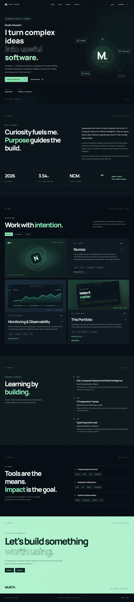
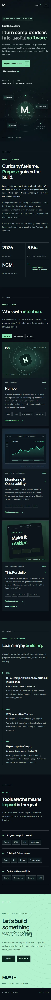
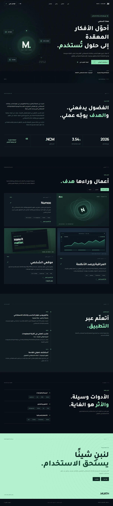
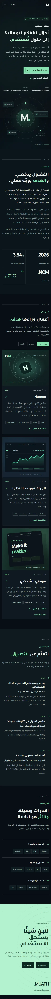

# Muath Alsulami — Portfolio

A bilingual personal portfolio presenting academic work, cooperative training, and a practical development workflow. Built with semantic HTML, CSS, and vanilla JavaScript; no build step or runtime framework is required.

[Live portfolio](https://muathmalsulami.github.io/learn-git-with-pathy/) · [Source repository](https://github.com/muathmalsulami/learn-git-with-pathy)

## Preview

Screenshots captured from the published site in English and Arabic.









## Features

- English and Arabic layouts, with local language preference when storage is available.
- Responsive navigation, project filters, and native dialog project notes.
- Keyboard focus styles, reduced-motion support, and readable content without JavaScript. Profile links and navigation remain available without scripts.
- Original illustrative project artwork. The monitoring graphic is not operational data.

## Run locally

Open `index.html` in a modern browser, or serve the folder with Python:

```sh
python -m http.server 8000
```

Visit `http://localhost:8000/`. Google Fonts are optional; system fonts are used as a fallback.

## Checks

With Node.js installed, run:

```sh
node --check script.js
node tests/integrity.mjs
```

The integrity check detects duplicate IDs, broken local fragments, missing referenced assets, and unsafe new-window links. The GitHub Actions workflow runs these checks and a Chromium interaction test for pushes and pull requests. The browser test can also be run with Playwright installed using `node tests/browser.cjs`. Browser, accessibility, and performance testing should also be repeated on the deployed site; automated checks alone do not establish WCAG conformance.

## Project context

This repository began as a Pathy Git & GitHub training project. Its history retains the original feature branch and merged pull request. The portfolio is a personal static website, not a deployed application backend. Numoo is a team graduation project: my contribution was application development and Flask integration, not training the models. The monitoring illustration is not operational data.

## Files

- `index.html` — structure and metadata
- `style.css` — responsive visual system and motion preferences
- `script.js` — language, navigation, filters, and project notes
- `assets/` — screenshots, social preview, and favicon
- `tests/` and `.github/workflows/` — static integrity checks and CI
- `goals.txt` — original training artifact

## Use

No open-source license has been granted for this repository. Contact the owner before reusing the portfolio's content or design.

## Development approach

The portfolio was developed with AI assistance, including OpenAI Codex, for design exploration, code and testing. Professional information is based on the owner’s supplied details; the owner makes the final creative decisions.

## Identity experiments

Two nonproduction identity experiments and their limitations are documented in [the experiment review](experiments/README.md). Neither is approved for release.
