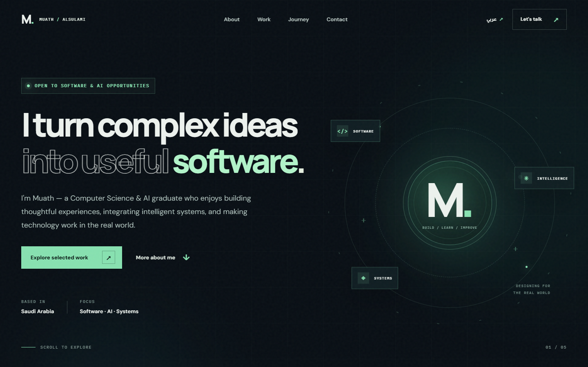
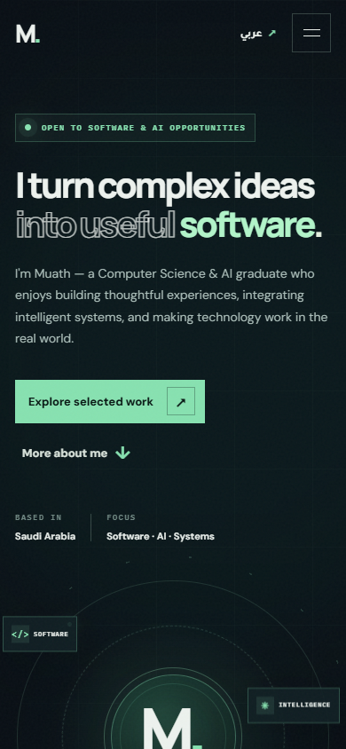

# Muath Alsulami — Portfolio

A bilingual personal portfolio presenting selected academic work, cooperative training, and the tools I use. Built with semantic HTML, CSS, and vanilla JavaScript; no build step or runtime framework is required.

[Source repository](https://github.com/muathmalsulami/learn-git-with-pathy)

Earlier design screenshot (deployment not yet verified):



## What is included

- English and Arabic layouts with language preference stored locally when available.
- Responsive navigation, project filters, and keyboard-accessible project notes.
- Reduced-motion support, visible focus styles, and content that remains readable without JavaScript.
- A direct link to the source and verified public professional profiles.



## Run locally

Open `index.html` in a modern browser, or serve the folder with Python:

```sh
python -m http.server 8000
```

Then visit `http://localhost:8000/`. Google Fonts are optional; system fonts are used as a fallback.

## Project context

This repository began as a Pathy Git & GitHub training project. Its history retains the original feature branch and merged pull request. The portfolio is a personal static website, not a deployed application backend. Numoo is a team graduation project: my contribution was to the application layer and integration of team-developed models. The monitoring illustration is not operational data.

## Files

- `index.html` — page structure and metadata
- `style.css` — responsive visual system and reduced-motion styles
- `script.js` — translation, navigation, filters, and project notes
- `assets/` — screenshots, social preview, and favicon
- `goals.txt` — original training artifact

## Contributing and reuse

Open an issue or pull request to suggest a correction. Review the content for accuracy before reuse. The portfolio content and design are not offered under an open-source license; all rights are reserved unless the owner specifies otherwise.
