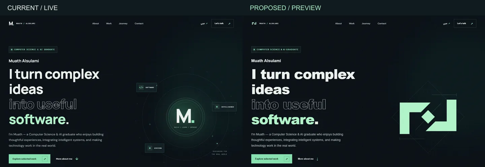
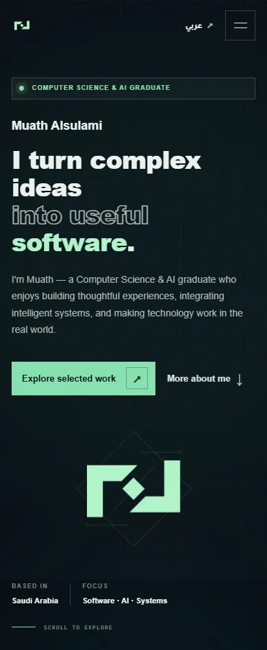

# Identity proposal: The Join

This branch is a proposal for review. The live site remains on the previous identity until the owner approves the change.

Two opposing, open forms meet around a small central diamond. The structure is intended to suggest connecting separate components into a useful whole. The mark is a single-color vector; its identity does not require a glow, lettering, or motion. The interactive version separates and recombines its components on activation. On pointer devices, the pieces move in opposing directions, then settle when the pointer leaves. Reduced motion presents the completed static mark.

## Creative review

Three directions were considered: a connected junction, a woven geometric form, and a linear signal. The junction and the woven form were built as working prototypes. The junction was selected because its two open forms and central connection remain legible as a simple one-color mark at small sizes; it avoids the denser central hexagon of the woven prototype and the familiar chart metaphor of the linear direction. These are design judgments, not proof of legal uniqueness or measured audience preference.

The current live orbital monogram and the proposed mark were recorded with identical viewport and pointer paths. The proposed mark adds a keyboard/touch-triggered decomposition, while the live monogram has a pointer parallax response. The recording uses a visual cursor marker that follows real pointer events and is not part of the site.

## References

Research informed the emphasis on a single interaction idea and motion that respects user preferences, without copying the referenced designs: [Codrops: architecture and interaction](https://tympanus.net/codrops/2026/07/15/the-architecture-behind-trionn-coordinating-gsap-three-js-lenis-and-web-audio/), [Codrops: identity-led interaction](https://tympanus.net/codrops/2026/07/21/magnetic-commerce-building-the-dash-creative-website/), [MDN: reduced motion](https://developer.mozilla.org/en-US/docs/Web/CSS/Reference/At-rules/%40media/prefers-reduced-motion).

## Verification and limits

- Edge and Firefox: pointer movement and return to rest, keyboard activation, touch activation, reduced motion, and horizontal overflow at eight widths in both languages.
- Existing project interactions, no-JavaScript navigation and contacts, Node integrity checks, and axe checks of the English and Arabic page and open-dialog states were exercised. Automated accessibility testing is not WCAG certification.
- Mobile Lighthouse was run against the local proposal. Public deployment measurements will be necessary only after approval and merge.
- Safari, screen-reader testing, actual browser zoom at 200% and 400%, field INP, and third-party social-preview rendering remain unverified.
- No claim of global trademark or visual uniqueness is made.
