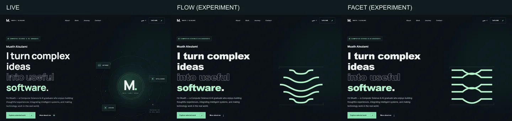

# Identity experiments — not approved

These are two interactive full-Hero explorations, not release candidates. The previously rejected junction remains in Git history and is not the current experiment. Neither option should be merged as a final identity without the owner's explicit approval.

## Run

Download and unzip this branch, then open `experiments/flow/index.html` or `experiments/facet/index.html` in a browser. Each includes the full portfolio layout and uses only local HTML, CSS and JavaScript plus optional Google Fonts. These are previews; they do not change the published site.

## Concepts and assessment

- **Flow:** five unevenly bounded paths move from differing tensions into a coherent field. A nearby pointer changes the paths; activation temporarily resolves them into straight lines. Advantage: legible interaction story and quiet composition. Weakness: the resting shape reads as a generic pattern and the small mark is not sufficiently distinctive.
- **Facet:** crossing paths form a structured weave; the same responsive field changes curvature and activation aligns it. Advantage: a more distinctive interlaced structure. Weakness: overlapping lines are crowded and become indistinct at small size; it may read as a generic technical motif.
- **Letterform study:** a custom personal-letter-inspired stroke was explored as a third, separate direction. It was not taken to a finished interactive prototype because its resting form looked too much like a generic Latin S.

The two full-Hero prototypes were compared with the current live layout. Neither is a final brand identity; Flow is the more restrained direction to refine, while Facet demonstrates a stronger but busier weave. Scores are provisional design judgments: Flow 58/100, Facet 54/100; no user preference, trademark clearance or independently measured memorability is implied.

## Motion evidence

[Flow: arrival, slow and fast pointer, return and activation](../evidence/flow.webm) · [Facet: same interaction sequence](../evidence/facet.webm) · [Flow: touch and reduced-motion demonstration](../evidence/mobile.webm). The on-screen circular pointer marker tracks actual test pointer events and is not part of the site.

## Verification and limits

Edge and Firefox were exercised locally for pointer path deformation, keyboard activation, touch activation, reduced-motion changes, and eight viewport widths in English and Arabic. The dynamic paths run through one requestAnimationFrame loop that stops after settling or when the document is hidden. Automated axe checks of the tested Flow page states found no violations; this is not a WCAG conformance finding. Mobile Lighthouse was measured on a local Flow prototype; `noindex` is intentional for these nonproduction previews. Safari, a screen reader, actual browser zoom at 200% and 400%, field INP and third-party social preview rendering remain unverified.

## Research

Principles studied include matching interaction to identity rather than adding a generic effect ([Codrops](https://tympanus.net/codrops/2026/07/21/magnetic-commerce-building-the-dash-creative-website/)), explaining motion through working prototypes ([Codrops](https://tympanus.net/codrops/2026/02/13/1820-productions-minimal-design-maximal-motion/)), and adapting visual weight to smaller contexts ([Google Design](https://design.google/library/evolving-google-identity)). These references informed the approach; they are not copied assets. No claim of legal uniqueness is made.
